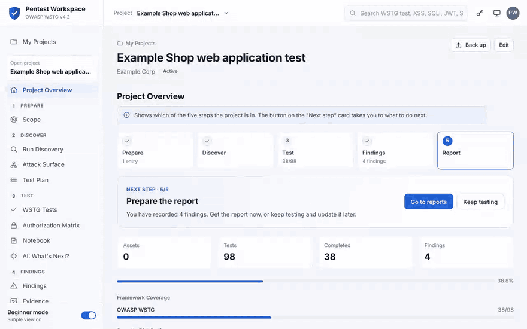
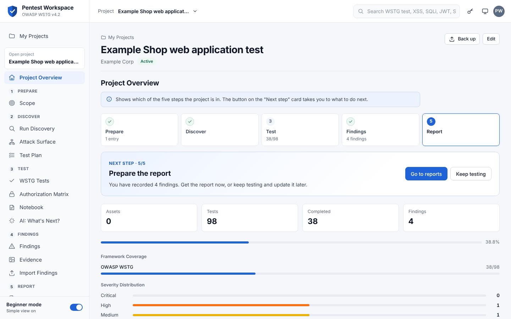
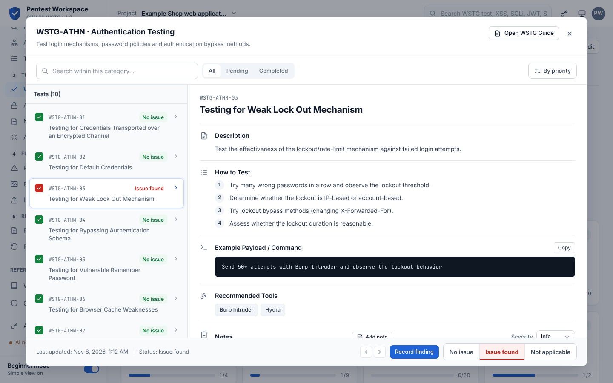
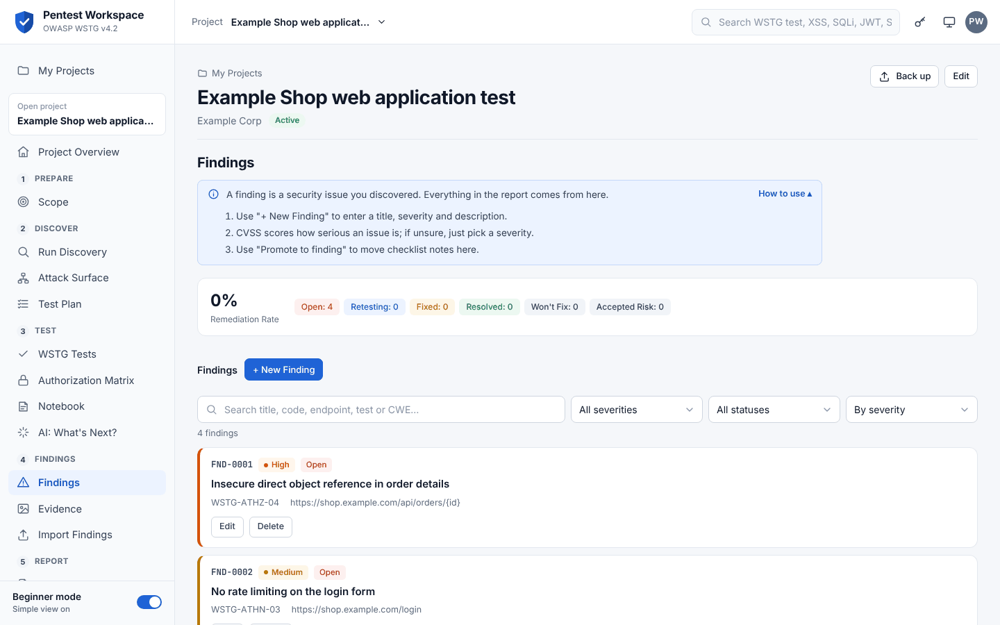
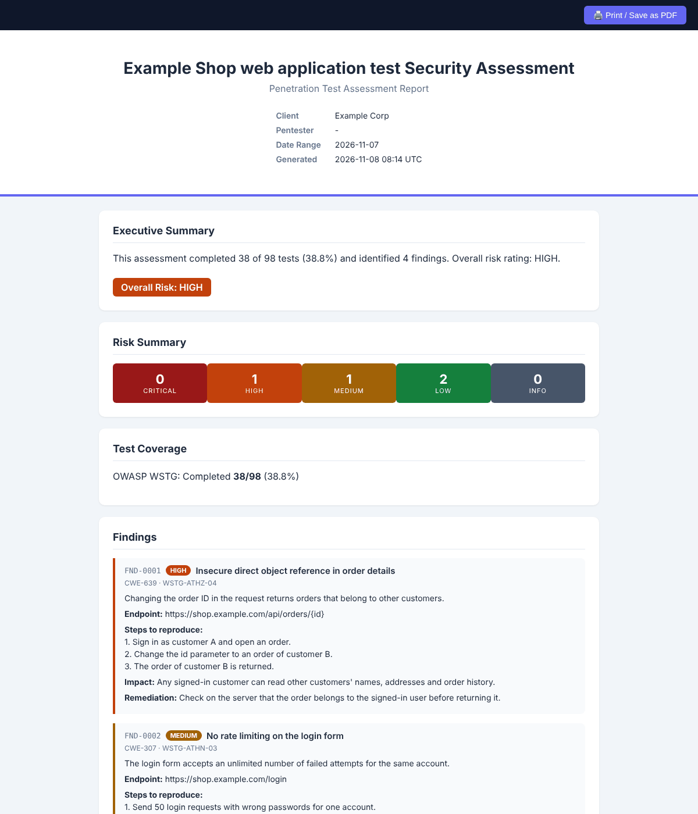

# Pentest Workspace

An independent pentest workspace based on the OWASP® Web Security Testing Guide (WSTG) v4.2.


**[Live demo](https://enesbaldemir.github.io/WSTG-Copilot/)** · **English** · **[Türkçe](README.tr.md)**



## Table of Contents

- [Quick Start](#quick-start)
- [Overview](#overview)
- [Screenshots](#screenshots)
- [Features](#features)
- [Tech Stack](#tech-stack)
- [Architecture](#architecture)
- [Requirements](#requirements)
- [Installation](#installation)
- [Environment Variables](#environment-variables)
- [Running](#running)
- [Running with Docker](#running-with-docker)
- [Authentication](#authentication)
- [Project Structure](#project-structure)
- [Contributing](#contributing)
- [License](#license)

## Quick Start

To look around first, open the **[live demo](https://enesbaldemir.github.io/WSTG-Copilot/)**. It runs the checklist in your browser; projects, findings, reports and AI need the local setup below.

With Docker (Docker Compose v2.24 or later):

```bash
git clone https://github.com/enesbaldemir/WSTG-Copilot.git
cd WSTG-Copilot
docker compose up -d --build
docker compose exec api python app.py set-password
```

Open `http://127.0.0.1:8000` and sign in with the password you set. To try only the checklist without the backend, serve the repository root with any static file server (`python -m http.server 8000`) and open the same address. See [Running with Docker](#running-with-docker) and [Running](#running) for details.

## Overview

Pentest Workspace is a web application for running penetration tests based on the **OWASP Web Security Testing Guide (WSTG) v4.2**. It combines the WSTG checklist with engagement management: scope definition, attack surface discovery, CVSS-scored findings, evidence collection, rule-based attack-chain correlation, a Kanban board and DOCX/HTML/PDF reporting. AI assistance (Anthropic, OpenAI, Google Gemini or Ollama) is optional and every AI output is a draft that the user reviews.

The checklist works with only a static file server. Projects, findings, evidence, reports and AI features require the Flask + SQLite backend.

> **Independent project:** Pentest Workspace is not an OWASP project and is not affiliated with or endorsed by the OWASP Foundation. It uses OWASP content under its Creative Commons license; see [License](#license).

## Screenshots

The screenshots use a demo project with example data.

| | |
|---|---|
|  |  |
| **Project overview:** the five steps, the next step and progress | **WSTG test:** steps, example command, tools and the result |
|  |  |
| **Findings:** sorted by severity, with search and filters | **Report:** generated from the findings, also as PDF and Word |

## Features

**Interface**
- Project-first flow: after sign-in, **My Projects** creates a project from a name (plus an optional target address, which is added to the scope without sending it any request) and opens it. The project's test session is created in the background, and the last project reopens on the next visit
- The project is a page, and the sidebar follows the pentest steps: Prepare (scope) · Discover · Test · Findings · Report. Discovery and the Test Plan open inside the project page rather than in pop-up windows; on phones a section picker under the project title replaces the sidebar
- **Beginner mode** (on by default, one click in the sidebar) hides Kanban, Attack Chains, Tools, Timeline, Study Metrics and the session picker. No data is deleted
- **WSTG Guide** shows every test without opening a project
- Guidance: the project overview shows a five-step bar and a **Next step** card (scope → optional discovery → tests → findings → report → retest) with a button that goes straight to the task; each page opens with a short "what is this / how to use it" box; empty pages explain what to do and offer the next action; hovering a WSTG code (e.g. `WSTG-ATHN-03`) explains it

**Checklist**
- 98 WSTG v4.2 test items in 12 categories; each item has a description, testing steps, an example payload/command and suggested tools
- Each test gets a result: **No issue**, **Issue found** or **Not applicable** (stored as `passed`, `failed`, `skipped`; the API rejects other values). "Issue found" offers a **Record finding** button that opens the finding form pre-filled with the test ID and title; the technical report lists the results in plain words
- Alternate checklist: OWASP LLM Top 10 (10 categories, 21 test items) for LLM-based targets
- OWASP Top 10:2025 reference module (10 categories) cross-linked to WSTG items
- Project-specific custom test items
- Global search, progress dashboard, Turkish/English interface
- Links to the official WSTG v4.2 guide: each category opens its chapter online, and the PDF is downloaded from the official release

**Projects and sessions** (backend required)
- Project backup: "Back up" downloads the whole project (scope, sessions and results, notes, findings, evidence files, authorization matrix, discovery and tool runs, timeline) as one JSON file; "Restore from backup" on My Projects creates a **new** project from it. Every field is validated by type, length and allowed values, IDs are regenerated and relationships re-mapped, and image contents are checked by magic bytes; a rejected file leaves nothing behind. Backups up to 16 MB (the server request limit) can be restored
- Projects with client, description, status and start/end dates; each project has a timeline of events
- Scope management: in-scope / out-of-scope domains, subdomains, IPs and CIDR ranges
- Named test sessions (name, tester, target URL); checklist progress is stored in SQLite and can be resumed. If the backend is unreachable, the app falls back to `localStorage`
- Attack Surface Discovery (recon): passive subdomain discovery via crt.sh Certificate Transparency logs, DNS resolution, a single HTTP fetch for technology fingerprinting, link/form/cookie extraction and a short list of well-known paths (`robots.txt`, `swagger.json`, `.git/config`, …). Results are mapped to WSTG test IDs, stored per project and shown again when the panel is reopened. Requires explicit authorization confirmation; targets resolving to private, loopback, link-local or reserved IPs are rejected (SSRF protection)
- Tool Runner: runs an allow-listed set of tools (`nmap`, `httpx`, `whatweb`, `subfinder`, `dnsx`) with fixed argument templates, shows a command preview first and keeps a run history per project. Commands are passed as argument lists (no shell); missing tools are reported as unavailable, never auto-installed
- Test Planner: rule-based priority queue that ranks WSTG items by recon evidence and methodology order, with the reason for each ranking
- AI "What's Next?": AI-generated suggestion for the next test based on completed tests and findings, with alternate candidates
- Import of Nmap (XML), Nikto (XML/JSON) and WPScan (JSON) output into findings linked to WSTG items
- Burp Suite (Issues XML export) and OWASP ZAP (XML/JSON report) import: issues are mapped to WSTG items (by issue name, then CWE) and can be created as professional findings in the current project with endpoint, parameter, CWE, description, remediation and references filled in. Burp's request/response (and ZAP's, in the "-plus" report formats) is attached as HTTP evidence with secrets redacted. Issues marked as false positive are skipped, and re-importing the same report does not create duplicates
- Notebook: per-session free-form notes, optionally linked to a WSTG item, with screenshots (PNG/JPEG/GIF/WebP, validated by content on the server; pasting works), CWE suggestions for the linked test, a server-computed CVSS v3.1 score, your own false-positive verdict and an optional AI analysis
- Study metrics (A/B): sessions can be assigned to an "AI-assisted" or "control" group. While a control session is open the AI buttons are hidden. The Study Metrics panel compares the groups (completion time, completion rate, findings, false-positive rate, AI calls and latency) and copies per-session data as CSV. Completion time is measured for sessions closed with "Complete" in the session list

**Findings**
- Finding templates: 24 built-in templates for common web issues (TR/EN description, impact, remediation, WSTG test, CWE, OWASP Top 10:2025, references) and your own templates via "Save as template" (stored without target-specific fields). Applying a template fills only empty fields
- Short finding form: a title and a severity are enough; **steps to reproduce (PoC)** has its own field and appears in the HTML/PDF report. Parameter, CWE, OWASP, impact, references and status sit under "More details", and the CVSS calculator is optional. When a CVSS score is entered the severity comes from it (the API enforces the same rule and rejects unknown severities)
- The findings list is sorted by severity (then CVSS), with search (title, code, endpoint, test ID, CWE) and severity/status filters; findings without reproduction steps are flagged
- Title, description, affected endpoint, remediation, CWE, severity and a CVSS v3.1 calculator with live scoring (client and server side)
- Duplicate detection based on title/description/endpoint/CWE similarity (`difflib`), with merge or create-anyway options
- Attack-chain correlation: findings are matched against 10 fixed attack-chain patterns (e.g. user enumeration → weak authentication → account takeover). No AI involved
- Kanban board for test results with the columns To Do, Testing, Review, Confirmed and Done
- Authorization matrix (project tab): roles as columns, endpoints as rows (added by hand or taken from the Attack Surface). For each cell you mark the expected access (allowed / denied) and what your own test showed; cells expected "denied" but accessible are highlighted and can be turned into WSTG-ATHZ-02/03 findings with one click. Exportable as CSV. The app never sends requests to the target

**Evidence**
- Screenshots can be pasted with Ctrl+V or dragged onto the Evidence page, and linked to a finding while uploading
- Screenshot upload (PNG/JPEG/WebP/GIF), stored under server-generated UUID file names
- Raw HTTP request/response evidence with automatic redaction of secrets and PII (Authorization headers, cookies, JWTs, common API key formats, private keys, e-mail addresses, card-like numbers); the unredacted text is only returned on explicit request
- Optional AI vision analysis of screenshots (Anthropic Claude, enabled only when `ANTHROPIC_API_KEY` is set) that suggests WSTG test IDs validated against the real dataset; suggestions are only attached after the user accepts them

**Reporting**
- The Reports page leads with one "Download PDF" button (plus Word and browser view); customization and the other Word templates sit in collapsible sections
- DOCX reports in three templates: Technical, Executive and Developer. Like the HTML/PDF report, they are built from the records on the Findings page (description, steps to reproduce, impact, the finding's own remediation, CVSS, status); projects with no records fall back to checklist notes. Coverage is reported against all WSTG tests, broken down into No issue / Issue found / Not applicable, and the Developer report leaves out closed or accepted findings
- Self-contained HTML report (single file, no external dependencies) with a print / save-as-PDF button
- Server-side PDF report generated with `xhtml2pdf` (cover page, executive summary, risk breakdown, per-finding details, appendices, page numbers) with an embedded font for Turkish characters
- Finding selection for HTML/PDF reports: all, critical + high only, or hand-picked
- "Authorization Testing" section in HTML/PDF reports built from the authorization matrix: summary, list of unauthorized access with linked finding codes and the colour-coded role × endpoint table (summary only in the Executive template; can be turned off in the report builder)
- Session-level reports (Markdown / DOCX) and an optional AI-drafted executive summary
- Retest workflow (project tab): findings the client reports as fixed are listed as pending; each is marked "Fixed" (status → Resolved) or "Still open" (reopened) with a note and screenshot evidence, and every retest is recorded in the timeline. A separate Retest Report (PDF/HTML) summarises verified, still-open and not-yet-retested findings

**AI assistance**
- Providers: Anthropic, OpenAI, Google Gemini, Ollama (local)
- AI Settings panel: store an encrypted (Fernet) API key per provider, choose the active provider and test the connection
- Bring Your Own Key (BYOK): each user can enter a personal key that is kept in the browser's `sessionStorage` and sent per request via `X-AI-*` headers; it is not stored on the server
- Uses: drafting descriptions and remediation, CWE/severity/CVSS suggestions, text rewriting, next-test suggestions, executive summary drafts
- Every AI call is logged (provider, model, latency, purpose, success/failure) and available at `/api/ai/logs`

## Tech Stack

| Layer | Technologies |
|---|---|
| Frontend | HTML5, CSS3, vanilla JavaScript (no framework, no build step), Inter font (Google Fonts) |
| Backend | Python, Flask 2.3, Flask-SQLAlchemy, Flask-CORS, SQLite |
| Reporting | `python-docx`, `xhtml2pdf` |
| Security | `cryptography` (Fernet) for stored AI keys |
| AI | Provider layer for Anthropic, OpenAI, Gemini and Ollama (HTTP via `requests`) |
| External tools (optional) | `nmap`, `httpx`, `whatweb`, `subfinder`, `dnsx` |

## Architecture

```
Browser (index.html + js/app.js)
   │  loads checklist data from data/*.json
   │  REST calls to http://localhost:5000/api  (+ optional X-AI-* BYOK headers)
   ▼
Flask API (backend/app.py)
   ├── SQLAlchemy models ──► SQLite (backend/database/wstg.db)
   ├── recon.py / tool_runner.py ──► target (after authorization + SSRF checks)
   ├── cvss.py, duplicate_detector.py, attack_chains.py, redaction.py   (rule-based)
   ├── report_builder.py / report_html.py / report_pdf.py / report_generator.py
   └── ai/factory.py ──► Anthropic | OpenAI | Gemini | Ollama
```

- The frontend is a static single-page application. It reads checklist content from `data/*.json` and talks to the backend at the fixed address `http://localhost:5000/api` (`API_BASE` in `js/app.js`). Without a backend it works in checklist-only mode using `localStorage`.
- The backend creates the database and tables on first start and adds missing columns to an existing database automatically.
- AI provider resolution order: BYOK request headers → active provider saved in the AI Settings panel → `.env` values. If none is configured, AI features are disabled; no placeholder content is generated.
- Uploaded evidence files are stored under `backend/uploads/`.

## Requirements

- Python 3 with `pip` and `venv`, or Docker (see [Running with Docker](#running-with-docker))
- A modern web browser
- Any static file server for the frontend (e.g. `python -m http.server`)
- Optional: `nmap`, `httpx`, `whatweb`, `subfinder`, `dnsx` on `PATH` for the Tool Runner
- Optional: an API key for Anthropic / OpenAI / Gemini, or a running Ollama instance, for AI features

## Installation

```bash
git clone https://github.com/enesbaldemir/WSTG-Copilot.git
cd WSTG-Copilot/backend
python -m venv venv
source venv/bin/activate        # Windows: venv\Scripts\activate
pip install -r requirements.txt
cp .env.example .env            # optional
```

## Environment Variables

All variables are optional and are read from `backend/.env`. AI keys are normally entered in the in-app AI Settings panel; the AI variables below are fallbacks for setups without a UI.

| Variable | Default | Description |
|---|---|---|
| `DATABASE_URL` | `sqlite:///<backend>/database/wstg.db` | SQLAlchemy database URL |
| `SECRET_KEY` | generated | Flask secret key. If empty, a random key is generated on first start and stored in `backend/instance/secret_key` (file mode `0600`, ignored by git) |
| `CORS_ORIGINS` | `http://localhost:8000,http://127.0.0.1:8000,http://localhost:3000,http://127.0.0.1:3000` | Allowed frontend origins. `POST`/`PUT`/`PATCH`/`DELETE` requests sent from any other origin are rejected with `403` |
| `ALLOWED_HOSTS` | `localhost,127.0.0.1,::1` | Accepted `Host` headers (DNS rebinding protection). Add this machine's name/IP if you expose the API with `WSTG_HOST` |
| `WSTG_HOST` / `WSTG_PORT` | `127.0.0.1` / `5000` | Address `python app.py` listens on. Anything other than loopback exposes the API to the network over plain HTTP; see [Authentication](#authentication) |
| `WSTG_SESSION_HOURS` | `12` | How long a sign-in lasts, counted from sign-in (not extended by activity) |
| `SESSION_COOKIE_SECURE` | off | `1` marks the session cookie `Secure`. Only enable it when the API is served over HTTPS, otherwise the browser will not send the cookie |
| `FLASK_DEBUG` | off | `1` enables the Werkzeug debugger. Refused unless the host is loopback, because a network-reachable debugger allows remote code execution |
| `LOG_LEVEL` | `INFO` | Log level |
| `ANTHROPIC_API_KEY` | empty | Enables AI vision analysis of evidence screenshots; also the Anthropic fallback key |
| `AI_PROVIDER` | `gemini` | Fallback provider: `gemini`, `openai`, `anthropic` or `ollama` |
| `AI_REQUEST_TIMEOUT` | `30` | AI request timeout in seconds |
| `GEMINI_API_KEY` / `GEMINI_MODEL` | empty / `gemini-3.7-flash` | Gemini key and model |
| `OPENAI_API_KEY` / `OPENAI_MODEL` | empty / `gpt-5.6-terra` | OpenAI key and model |
| `ANTHROPIC_MODEL` | `claude-sonnet-5` | Anthropic model |
| `OLLAMA_BASE_URL` / `OLLAMA_MODEL` | `http://localhost:11434` / `llama3.1` | Ollama server and model |
| `ENCRYPTION_KEY` | derived from `SECRET_KEY` | Key used to encrypt API keys saved in AI Settings. If it is not set and `SECRET_KEY` changes, saved keys must be re-entered |

Do not commit `backend/.env`; it is already listed in `.gitignore`.

## Running

1. Start the backend (from `backend/`, with the virtual environment active):

   ```bash
   python app.py
   ```

   The API listens on `http://127.0.0.1:5000` with the debugger off. On first start it creates `backend/instance/secret_key` if `SECRET_KEY` is not set; AI keys saved by older versions under the old built-in key are re-encrypted automatically.

2. Serve the frontend from the repository root in a second terminal:

   ```bash
   python -m http.server 8000
   ```

3. Open `http://localhost:8000` (or `http://127.0.0.1:8000`). The frontend detects the backend automatically. On first open you are asked to set a password; after that you sign in.

For checklist-only use, step 1 can be skipped; progress is then kept in `localStorage` and no sign-in is needed.

If an unexpected error occurs, the interface shows a short error ID (e.g. `hata kimliği: 3f9a1c2e`) instead of internal details; the full traceback is printed in the backend terminal under the same ID.

## Running with Docker

Docker runs the API and the frontend without installing Python. You need Docker with Docker Compose v2.24 or later.

```bash
git clone https://github.com/enesbaldemir/WSTG-Copilot.git
cd WSTG-Copilot
docker compose up -d --build
docker compose exec api python app.py set-password
```

Then open `http://localhost:8000` and sign in with the password you set.

- **Password:** The interface cannot set the first password when the API runs in a container, because requests reach the container from the Docker network rather than from `127.0.0.1`. Set it with the `set-password` command above; the same command resets it later.
- **Ports:** The API (`5000`) and the frontend (`8000`) are published on `127.0.0.1` only, so they are not reachable from other machines.
- **Data:** The database and the generated secret key are stored in the `wstg-data` volume, and evidence files in `wstg-uploads`. They are kept across `docker compose down` and rebuilds; `docker compose down -v` deletes them.
- **Settings:** `backend/.env` is read if it exists (see [Environment Variables](#environment-variables)). For Ollama running on the same computer, set `OLLAMA_BASE_URL=http://host.docker.internal:11434`.
- **Tool Runner:** `nmap`, `httpx`, `whatweb`, `subfinder` and `dnsx` are not included in the image, so the Tool Runner reports them as not installed.
- **Update:** `git pull`, then `docker compose up -d --build`.
- **Stop:** `docker compose down`.

## Authentication

The backend is single-user and protected by a password.

- **First password.** The first time the interface is opened it asks for a password of at least 12 characters. This screen only works from the computer running the API (loopback address), so nobody on the network can claim the workspace first. On a headless or remote setup, set it in a terminal with `python app.py set-password`.
- **Sign-in.** The session is Flask's signed session cookie `wstg_session` (`HttpOnly`, `SameSite=Strict`), valid for 12 hours from sign-in. Without it every `/api` endpoint returns `401`, except `/api/auth/status`, `/api/auth/setup`, `/api/auth/login` and `/api/auth/logout`. When a session ends, the interface returns to the sign-in screen.
- **Storage.** Only a salted hash (`werkzeug.security`) is stored, in the `auth_settings` table. The table is created automatically on start. Existing data is not touched.
- **Failed attempts.** After 5 failed attempts from the same address, sign-in is locked for 30 seconds, doubling up to 15 minutes. The counter is kept in memory and resets when the backend restarts.
- **Change password / sign out.** Both are in the sidebar. Changing the password signs out every other browser; the current one stays signed in.
- **Forgot the password.** Run `python app.py set-password` in `backend/` (the backend can keep running). The password is asked twice and never passed as an argument. All open sessions are signed out.
- **localhost vs 127.0.0.1.** Browsers treat these as different sites, so the frontend calls the API on the same host the page was opened from (`127.0.0.1:8000` → `127.0.0.1:5000`, `localhost:8000` → `localhost:5000`). Each address needs its own sign-in.

**Upgrading.** After updating, the backend requires a sign-in. Open the interface on the API machine and set a password, or run `python app.py set-password`. Projects, findings and evidence are kept as they are.

## Project Structure

```
WSTG-Copilot/
├── index.html                  # Single-page frontend
├── css/style.css               # Styles
├── js/
│   ├── app.js                  # Application logic, i18n, API client, AI/BYOK panels
│   ├── auth.js                 # API address selection and auth error codes
│   ├── cvss.js                 # CVSS v3.1 calculator
│   └── import-parsers.js       # Nmap / Nikto / WPScan parsers
├── data/
│   ├── wstg-checklist.{tr,en}.json
│   ├── owasp-top10.{tr,en}.json
│   ├── llm-security-checklist.{tr,en}.json
│   └── LICENSE.md              # CC BY-SA 4.0 notice and sources
├── backend/
│   ├── app.py                  # Flask REST API
│   ├── models.py               # SQLAlchemy models
│   ├── config.py               # Configuration from environment variables
│   ├── auth.py                 # Password hashing, policy, login throttling
│   ├── security.py             # Local-only defaults (host, debug, CORS, Origin/Host checks)
│   ├── ai/                     # Provider layer (factory + Anthropic/OpenAI/Gemini/Ollama)
│   ├── ai_report_assistant.py  # Description / remediation / rewrite / summary prompts
│   ├── finding_analysis.py     # AI CWE / severity / CVSS suggestion
│   ├── next_test_suggestion.py # AI next-test suggestion
│   ├── evidence_intel.py       # Optional AI screenshot analysis
│   ├── recon.py                # Attack Surface Discovery
│   ├── tool_runner.py          # Allow-listed external tool execution
│   ├── attack_chains.py        # Rule-based attack-chain correlation
│   ├── duplicate_detector.py   # Duplicate finding detection
│   ├── redaction.py            # Secret / PII redaction
│   ├── crypto_utils.py         # Fernet encryption for stored keys
│   ├── mapping.py              # WSTG ↔ OWASP Top 10 ↔ CWE index
│   ├── notes.py                # Notebook input / image validation
│   ├── authz_matrix.py         # Authorization matrix validation
│   ├── study_metrics.py        # A/B study metrics
│   ├── cvss.py                 # CVSS v3.1 scoring
│   ├── report_builder.py       # DOCX project reports
│   ├── project_backup.py       # Project backup export / restore
│   ├── report_html.py          # HTML report
│   ├── report_pdf.py           # PDF report
│   ├── report_generator.py     # Session-level reports
│   ├── report_retest.py        # Retest report
│   ├── retest.py               # Retest workflow rules
│   ├── test_*.py               # Tests
│   ├── .env.example
│   └── requirements.txt
├── Dockerfile                  # Image for the API and the frontend
├── docker-compose.yml          # Starts both services (see Running with Docker)
├── README.tr.md                # Turkish README
├── CONTRIBUTING.md             # How to contribute
├── SECURITY.md                 # How to report vulnerabilities
├── CHANGELOG.md                # Release notes
└── LICENSE
```

## Contributing

Bug reports, ideas and pull requests are welcome. See [CONTRIBUTING.md](CONTRIBUTING.md) for how to run the tests and open a pull request. To report a security vulnerability, follow [SECURITY.md](SECURITY.md) instead of opening a public issue.

## Disclaimer

This tool is intended for **authorized** security testing and educational use only. Testing systems without the owner's explicit permission is illegal. Recon and the Tool Runner only act on targets you specify and require you to confirm authorization. You are responsible for how you use this project.

## License

The code (everything outside `data/`) is released under the [MIT License](LICENSE).

The checklists and reference data in [`data/`](data/) are adapted and translated from OWASP material and are released under the [Creative Commons Attribution-ShareAlike 4.0 International License](https://creativecommons.org/licenses/by-sa/4.0/) (CC BY-SA 4.0), the license of the original works. See [`data/LICENSE.md`](data/LICENSE.md) for the sources and the changes made.

| Source | Creator | License |
|---|---|---|
| [OWASP Web Security Testing Guide v4.2](https://owasp.org/www-project-web-security-testing-guide/) | OWASP Foundation and WSTG contributors | CC BY-SA 4.0 |
| [OWASP Top 10:2025](https://owasp.org/Top10/2025/) | OWASP Foundation and the OWASP Top 10 team | CC BY-SA 4.0 |
| [OWASP Top 10 for LLM Applications 2025](https://github.com/OWASP/www-project-top-10-for-large-language-model-applications) | OWASP Foundation and the OWASP GenAI Security Project | CC BY-SA 4.0 |

The WSTG v4.2 PDF is not included in this repository. Download it from the [official WSTG v4.2 release](https://github.com/OWASP/wstg/releases/download/v4.2/wstg-v4.2.pdf) or read the guide [online](https://wstg.owasp.org/v4.2/).

Pentest Workspace is an independent tool. It is not an OWASP project and is not affiliated with or endorsed by the OWASP Foundation. OWASP® is a registered trademark of the OWASP Foundation, Inc. The OWASP logo is not used in this project.
