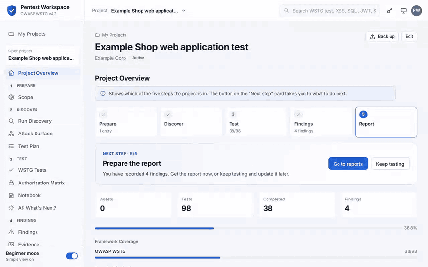
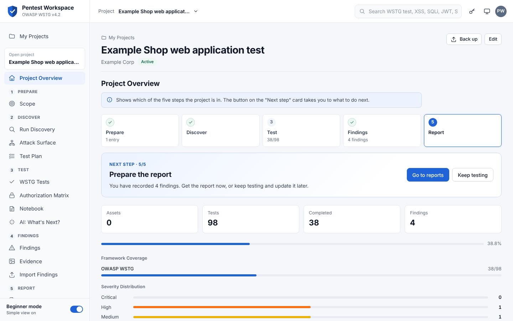
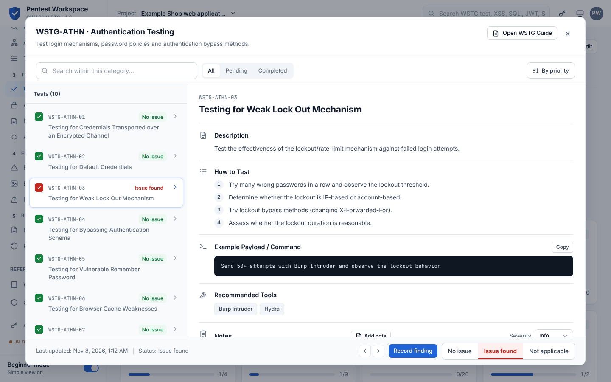
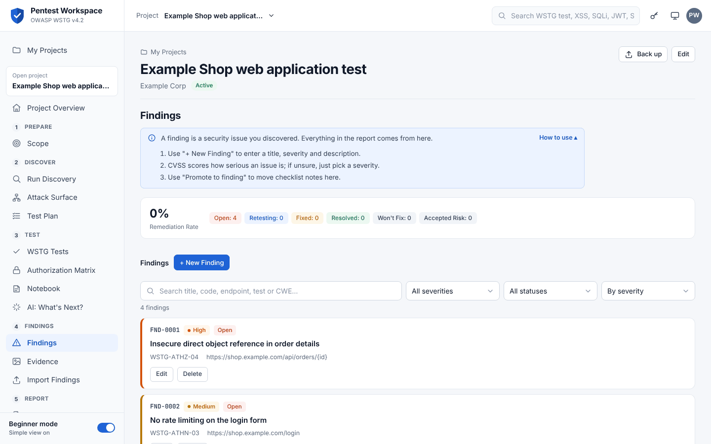
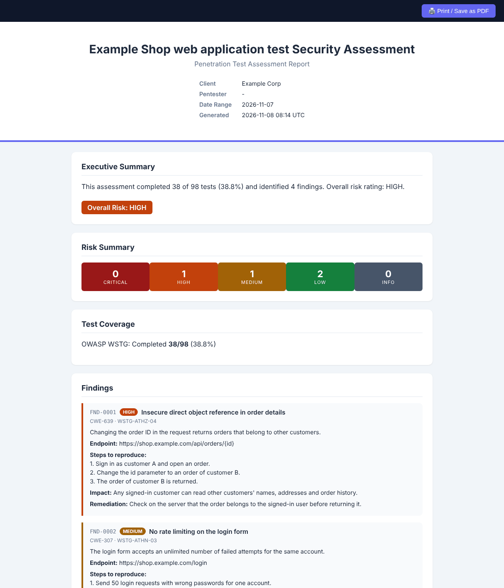

# Pentest Workspace

OWASP® Web Security Testing Guide (WSTG) v4.2 tabanlı, bağımsız bir pentest çalışma alanı.


**[English](README.md)** · **Türkçe**



## İçindekiler

- [Hızlı Başlangıç](#hızlı-başlangıç)
- [Genel Bakış](#genel-bakış)
- [Ekran Görüntüleri](#ekran-görüntüleri)
- [Özellikler](#özellikler)
- [Kullanılan Teknolojiler](#kullanılan-teknolojiler)
- [Mimari](#mimari)
- [Gereksinimler](#gereksinimler)
- [Kurulum](#kurulum)
- [Ortam Değişkenleri](#ortam-değişkenleri)
- [Çalıştırma](#çalıştırma)
- [Docker ile Çalıştırma](#docker-ile-çalıştırma)
- [Kimlik Doğrulama](#kimlik-doğrulama)
- [Proje Klasör Yapısı](#proje-klasör-yapısı)
- [Katkıda Bulunma](#katkıda-bulunma)
- [Lisans](#lisans)

## Hızlı Başlangıç

Docker ile (Docker Compose v2.24 veya üzeri):

```bash
git clone https://github.com/enesbaldemir/WSTG-Copilot.git
cd WSTG-Copilot
docker compose up -d --build
docker compose exec api python app.py set-password
```

`http://127.0.0.1:8000` adresini açın ve belirlediğiniz parolayla giriş yapın. Backend olmadan yalnızca checklist'i denemek için depo kök dizinini herhangi bir statik dosya sunucusuyla sunun (`python -m http.server 8000`) ve aynı adresi açın. Ayrıntılar için [Docker ile Çalıştırma](#docker-ile-çalıştırma) ve [Çalıştırma](#çalıştırma) bölümlerine bakın.

## Genel Bakış

Pentest Workspace, **OWASP Web Security Testing Guide (WSTG) v4.2** temelli sızma testleri yürütmek için geliştirilmiş bir web uygulamasıdır. WSTG checklist'ini engagement yönetimiyle birleştirir: kapsam tanımı, saldırı yüzeyi keşfi, CVSS puanlı bulgular, kanıt toplama, kural tabanlı saldırı zinciri korelasyonu, Kanban panosu ve DOCX/HTML/PDF raporlama. AI desteği (Anthropic, OpenAI, Google Gemini veya Ollama) opsiyoneldir ve üretilen her çıktı kullanıcının gözden geçirdiği bir taslaktır.

Checklist yalnızca statik bir dosya sunucusuyla çalışır. Projeler, bulgular, kanıtlar, raporlar ve AI özellikleri için Flask + SQLite backend'i gerekir.

> **Bağımsız proje:** Pentest Workspace bir OWASP projesi değildir; OWASP Foundation ile bağlantılı değildir ve OWASP Foundation tarafından desteklenmemektedir. OWASP içeriklerini Creative Commons lisansına uygun olarak kullanır; ayrıntılar için [Lisans](#lisans) bölümüne bakın.

## Ekran Görüntüleri

Ekran görüntülerinde örnek verilerle hazırlanmış bir demo proje kullanılmıştır.

| | |
|---|---|
|  |  |
| **Proje genel bakışı:** beş adım, sıradaki adım ve ilerleme | **WSTG testi:** adımlar, örnek komut, araçlar ve sonuç |
|  |  |
| **Bulgular:** önem derecesine göre sıralı, arama ve filtrelerle | **Rapor:** bulgulardan üretilir; PDF ve Word olarak da alınabilir |

## Özellikler

**Arayüz**
- Proje odaklı akış: girişten sonra **Projelerim** sayfasında yalnızca bir adla (isteğe bağlı hedef adresiyle; adres kapsama eklenir, ona istek gönderilmez) proje oluşturulur ve açılır. Projenin test oturumu arka planda hazırlanır; sonraki açılışta son proje kaldığı yerden açılır
- Proje bir sayfadır; kenar çubuğu pentest adımlarına göre gruplanır: Hazırlık (kapsam) · Keşif · Test · Bulgular · Rapor. Keşif ve Test Planı açılır pencere yerine proje sayfasının içinde açılır; telefonda proje başlığının altındaki bölüm seçici kenar çubuğunun işini görür
- **Başlangıç modu** (varsayılan açık, kenar çubuğunda tek tık) Kanban, Saldırı Zincirleri, Araçlar, Zaman Çizelgesi, Çalışma Metrikleri ve oturum seçiciyi gizler. Hiçbir veri silinmez
- **WSTG Rehberi** tüm testleri proje açmadan gösterir
- Rehberlik: proje özetinde beş adımlı çubuk ve doğrudan ilgili işe götüren **Sıradaki adım** kartı (kapsam → isteğe bağlı keşif → testler → bulgular → rapor → yeniden test); her sayfanın başında kısa bir "bu ne işe yarar / nasıl kullanılır" kutusu; boş sayfalarda ne yapılacağını anlatan açıklama ve sonraki işe götüren düğmeler; bir WSTG kodunun (ör. `WSTG-ATHN-03`) üzerine gelince açıklaması

**Checklist**
- 12 kategoride 98 WSTG v4.2 test maddesi; her maddede açıklama, test adımları, örnek payload/komut ve önerilen araçlar
- Her testin sonucu girilir: **Açık yok**, **Açık bulundu** ya da **Uygulanamaz** (`passed`, `failed`, `skipped` olarak saklanır; API başka değer kabul etmez). "Açık bulundu" seçilince test ID'si ve başlığı dolu bulgu formunu açan **Bulgu kaydet** düğmesi çıkar; teknik rapor sonuçları okunur biçimde listeler
- Alternatif checklist: LLM tabanlı hedefler için OWASP LLM Top 10 (10 kategori, 21 test maddesi)
- WSTG maddelerine bağlantılı OWASP Top 10:2025 referans modülü (10 kategori)
- Projeye özel test maddeleri
- Global arama, ilerleme paneli, Türkçe/İngilizce arayüz
- Resmî WSTG v4.2 rehberine bağlantılar: her kategori kendi bölümünü çevrimiçi açar, PDF resmî sürümden indirilir

**Projeler ve oturumlar** (backend gerekir)
- Proje yedekleme: "Yedekle", projenin tamamını (kapsam, oturumlar ve sonuçlar, notlar, bulgular, kanıt dosyaları, yetki matrisi, keşif ve araç çalıştırmaları, zaman çizelgesi) tek bir JSON dosyası olarak indirir; Projelerim'deki "Yedekten geri yükle" bundan **yeni** bir proje oluşturur. Her alan tür, uzunluk ve izin verilen değerlere göre doğrulanır, kimlikler yeniden üretilip ilişkiler eşlenir, görsel içerikleri magic byte ile kontrol edilir; reddedilen dosya geride hiçbir şey bırakmaz. 16 MB'a kadar (sunucunun istek sınırı) yedekler geri yüklenebilir
- Müşteri, açıklama, durum ve başlangıç/bitiş tarihi içeren projeler; her projenin olay zaman çizelgesi
- Kapsam yönetimi: kapsam içi/dışı domain, subdomain, IP ve CIDR aralıkları
- İsimli test oturumları (isim, test uzmanı, hedef URL); checklist ilerlemesi SQLite'a kaydedilir ve devam ettirilebilir. Backend'e erişilemezse uygulama `localStorage` moduna geçer
- Attack Surface Discovery (recon): crt.sh Certificate Transparency kayıtları üzerinden pasif subdomain keşfi, DNS çözümleme, teknoloji tespiti için tek bir HTTP isteği, link/form/cookie çıkarımı ve kısa bir iyi bilinen yol listesinin kontrolü (`robots.txt`, `swagger.json`, `.git/config`, …). Sonuçlar WSTG test ID'leriyle eşleştirilir, proje bazında saklanır ve panel yeniden açıldığında tekrar gösterilir. Yetki onayı zorunludur; private, loopback, link-local veya reserved IP'ye çözümlenen hedefler reddedilir (SSRF koruması)
- Tool Runner: izin listesindeki araçları (`nmap`, `httpx`, `whatweb`, `subfinder`, `dnsx`) sabit argüman şablonlarıyla çalıştırır, önce komut önizlemesi gösterir ve proje bazında çalıştırma geçmişi tutar. Komutlar shell kullanılmadan argüman listesi olarak verilir; kurulu olmayan araçlar "kullanılamaz" olarak bildirilir, otomatik kurulum yapılmaz
- Test Planı: WSTG maddelerini recon kanıtı ve metodoloji sırasına göre sıralayan, her sıralamanın gerekçesini gösteren kural tabanlı öncelik kuyruğu
- AI: Sırada Ne Var?: tamamlanan testlere ve bulgulara göre bir sonraki test için AI önerisi ve alternatif adaylar
- Nmap (XML), Nikto (XML/JSON) ve WPScan (JSON) çıktılarını WSTG maddelerine bağlı bulgulara dönüştüren içe aktarma
- Burp Suite (Issues XML dışa aktarımı) ve OWASP ZAP (XML/JSON rapor) içe aktarma: sorunlar WSTG maddelerine eşlenir (önce sorun adına, sonra CWE'ye göre) ve açık projede endpoint, parametre, CWE, açıklama, çözüm önerisi ve kaynaklar dolu profesyonel bulgu olarak oluşturulabilir. Burp'ün (ve "-plus" rapor biçimlerinde ZAP'ın) istek/yanıtı gizli bilgileri maskelenmiş HTTP kanıtı olarak eklenir. Yanlış pozitif işaretli sorunlar atlanır; aynı rapor tekrar içe aktarıldığında kopya oluşmaz
- Not Defteri: oturuma bağlı serbest notlar; istenirse bir WSTG maddesine bağlanır. Ekran görüntüsü (PNG/JPEG/GIF/WebP; sunucuda içeriğe göre doğrulanır, yapıştırma da çalışır), bağlı teste göre CWE önerileri, sunucuda hesaplanan CVSS v3.1 skoru, kendi false-positive kararınız ve opsiyonel AI analizi
- Çalışma metrikleri (A/B): oturumlar "AI destekli" veya "kontrol" grubuna atanabilir; kontrol oturumu açıkken AI düğmeleri gizlenir. Çalışma Metrikleri paneli grupları karşılaştırır (tamamlama süresi, tamamlanma oranı, bulgu sayısı, false-positive oranı, AI çağrısı ve gecikmesi) ve oturum verisini CSV olarak kopyalar. Süre, oturum listesinden "Tamamla" ile kapatılan oturumlar için ölçülür

**Bulgular**
- Bulgu şablonları: sık görülen web açıkları için 24 hazır şablon (TR/EN açıklama, etki, çözüm, WSTG testi, CWE, OWASP Top 10:2025, referanslar) ve "Şablon olarak kaydet" ile kendi şablonların (hedefe özel alanlar saklanmaz). Şablon yalnızca boş alanları doldurur
- Kısa bulgu formu: başlık ve önem derecesi yeterli; **tekrarlama adımları (PoC)** ayrı bir alandır ve HTML/PDF raporda yer alır. Parametre, CWE, OWASP, etki, referanslar ve durum "Ayrıntılar" altındadır; CVSS hesaplayıcı isteğe bağlıdır. CVSS puanı girilirse önem derecesi puandan gelir (API de aynı kuralı uygular ve bilinmeyen önem derecelerini reddeder)
- Bulgu listesi önem derecesine (sonra CVSS'e) göre sıralanır; başlık, kod, endpoint, test ID ve CWE ile aranabilir, önem derecesi ve duruma göre filtrelenebilir; tekrarlama adımı olmayan bulgular işaretlenir
- Başlık, açıklama, etkilenen endpoint, remediation, CWE, önem derecesi ve canlı skor hesaplayan CVSS v3.1 hesaplayıcı (istemci ve sunucu tarafı)
- Başlık/açıklama/endpoint/CWE benzerliğine (`difflib`) dayalı tekrar tespiti; birleştir ya da yine de oluştur seçenekleri
- Saldırı zinciri korelasyonu: bulgular 10 sabit saldırı zinciri kalıbıyla eşleştirilir (ör. kullanıcı numaralandırma → zayıf kimlik doğrulama → hesap ele geçirme). AI kullanılmaz
- Test sonuçları için Yapılacak, Test Ediliyor, İncelemede, Onaylandı ve Tamamlandı sütunlarından oluşan Kanban panosu
- Yetkilendirme matrisi (proje sekmesi): roller sütun, endpoint'ler satır (elle ya da Saldırı Yüzeyi'nden eklenir). Her hücrede beklenen erişimi (izinli / yasak) ve kendi denemenizin sonucunu işaretlersiniz; beklenen "yasak" iken erişilebilen hücreler vurgulanır ve tek tıkla WSTG-ATHZ-02/03 bulgusuna dönüştürülebilir. CSV olarak dışa aktarılabilir. Uygulama hedefe istek göndermez

**Kanıtlar**
- Ekran görüntüsü Kanıtlar sayfasında Ctrl+V ile yapıştırılabilir ya da sürükleyip bırakılabilir; yüklerken bir bulguya bağlanabilir
- Ekran görüntüsü yükleme (PNG/JPEG/WebP/GIF); dosyalar sunucu tarafında üretilen UUID adlarıyla saklanır
- Gizli bilgi ve kişisel verilerin otomatik maskelendiği ham HTTP request/response kanıtı (Authorization header'ları, cookie'ler, JWT'ler, yaygın API key formatları, private key'ler, e-posta adresleri, kart benzeri numaralar); maskelenmemiş metin yalnızca açık istek üzerine döner
- Ekran görüntüleri için opsiyonel AI görsel analizi (Anthropic Claude, yalnızca `ANTHROPIC_API_KEY` tanımlıysa etkin): gerçek veri setine göre doğrulanmış WSTG test ID'leri önerir; öneriler kullanıcı onaylamadan bağlanmaz

**Raporlama**
- Raporlar sayfası tek bir "PDF indir" düğmesiyle (yanında Word ve tarayıcıda aç) başlar; özelleştirme ve diğer Word şablonları katlanır bölümlerdedir
- Üç şablonlu DOCX rapor: Technical, Executive ve Developer. HTML/PDF rapor gibi Bulgular sayfasındaki kayıtlardan oluşur (açıklama, tekrarlama adımları, etki, bulgunun kendi çözüm önerisi, CVSS, durum); hiç kaydı olmayan projelerde checklist notları kullanılır. Kapsam tüm WSTG testlerine göre ve Açık yok / Açık bulundu / Uygulanamaz kırılımıyla verilir; Developer raporu kapatılmış ya da kabul edilmiş bulguları içermez
- Yazdır / PDF olarak kaydet butonlu, harici bağımlılığı olmayan tek dosyalık HTML rapor
- `xhtml2pdf` ile sunucu tarafında üretilen PDF rapor (kapak, yönetici özeti, risk dağılımı, bulgu detayları, ekler, sayfa numaraları); Türkçe karakterler için gömülü font
- HTML/PDF raporlarında bulgu seçimi: tümü, yalnızca kritik + yüksek ya da tek tek seçim
- HTML/PDF raporlarında yetkilendirme matrisinden üretilen "Yetkilendirme Testleri" bölümü: özet, bağlı bulgu kodlarıyla izinsiz erişim listesi ve renkli rol × endpoint tablosu (Yönetici şablonunda yalnızca özet; rapor oluşturucudan kapatılabilir)
- Oturum bazlı raporlar (Markdown / DOCX) ve opsiyonel AI destekli yönetici özeti taslağı
- Yeniden test akışı (proje sekmesi): müşterinin düzelttiğini bildirdiği bulgular "bekleyen" olarak listelenir; her biri not ve ekran görüntüsü kanıtıyla "Düzeldi" (durum → Kapatıldı) ya da "Hâlâ açık" (yeniden açılır) olarak işaretlenir ve her yeniden test zaman çizelgesine yazılır. Ayrı bir Yeniden Test Raporu (PDF/HTML) doğrulanan, açık kalan ve henüz yeniden test edilmeyen bulguları özetler

**AI desteği**
- Sağlayıcılar: Anthropic, OpenAI, Google Gemini, Ollama (yerel)
- AI Ayarları paneli: sağlayıcı bazında şifreli (Fernet) API key saklama, aktif sağlayıcı seçimi ve bağlantı testi
- Kendi Key'ini Kullan (BYOK): her kullanıcı kişisel key'ini girebilir; key tarayıcının `sessionStorage`'ında tutulur, her istekte `X-AI-*` header'larıyla gönderilir ve sunucuda saklanmaz
- Kullanım alanları: açıklama ve remediation taslağı, CWE/önem/CVSS önerisi, metin yeniden yazımı, sonraki test önerisi, yönetici özeti taslağı
- Her AI çağrısı (sağlayıcı, model, gecikme, amaç, başarı/hata) loglanır ve `/api/ai/logs` üzerinden görüntülenebilir

## Kullanılan Teknolojiler

| Katman | Teknolojiler |
|---|---|
| Frontend | HTML5, CSS3, vanilla JavaScript (framework ve build adımı yok), Inter yazı tipi (Google Fonts) |
| Backend | Python, Flask 2.3, Flask-SQLAlchemy, Flask-CORS, SQLite |
| Raporlama | `python-docx`, `xhtml2pdf` |
| Güvenlik | Saklanan AI key'leri için `cryptography` (Fernet) |
| AI | Anthropic, OpenAI, Gemini ve Ollama için sağlayıcı katmanı (`requests` ile HTTP) |
| Dış araçlar (opsiyonel) | `nmap`, `httpx`, `whatweb`, `subfinder`, `dnsx` |

## Mimari

```
Tarayıcı (index.html + js/app.js)
   │  checklist verisini data/*.json dosyalarından yükler
   │  http://localhost:5000/api adresine REST çağrıları (+ opsiyonel X-AI-* BYOK header'ları)
   ▼
Flask API (backend/app.py)
   ├── SQLAlchemy modelleri ──► SQLite (backend/database/wstg.db)
   ├── recon.py / tool_runner.py ──► hedef (yetki onayı + SSRF kontrolünden sonra)
   ├── cvss.py, duplicate_detector.py, attack_chains.py, redaction.py   (kural tabanlı)
   ├── report_builder.py / report_html.py / report_pdf.py / report_generator.py
   └── ai/factory.py ──► Anthropic | OpenAI | Gemini | Ollama
```

- Frontend statik, tek sayfalık bir uygulamadır. Checklist içeriğini `data/*.json` dosyalarından okur ve backend ile sabit `http://localhost:5000/api` adresi üzerinden konuşur (`js/app.js` içindeki `API_BASE`). Backend yoksa `localStorage` kullanan yalnızca-checklist modunda çalışır.
- Backend ilk açılışta veritabanını ve tabloları oluşturur, mevcut bir veritabanındaki eksik kolonları otomatik ekler.
- AI sağlayıcı seçim sırası: BYOK istek header'ları → AI Ayarları panelinde aktif edilen sağlayıcı → `.env` değerleri. Hiçbiri yoksa AI özellikleri devre dışı kalır; sahte içerik üretilmez.
- Yüklenen kanıt dosyaları `backend/uploads/` altında saklanır.

## Gereksinimler

- Python 3 (`pip` ve `venv` ile) ya da Docker (bkz. [Docker ile Çalıştırma](#docker-ile-çalıştırma))
- Güncel bir web tarayıcısı
- Frontend için herhangi bir statik dosya sunucusu (ör. `python -m http.server`)
- Opsiyonel: Tool Runner için `PATH` üzerinde `nmap`, `httpx`, `whatweb`, `subfinder`, `dnsx`
- Opsiyonel: AI özellikleri için Anthropic / OpenAI / Gemini API key'i ya da çalışan bir Ollama sunucusu

## Kurulum

```bash
git clone https://github.com/enesbaldemir/WSTG-Copilot.git
cd WSTG-Copilot/backend
python -m venv venv
source venv/bin/activate        # Windows: venv\Scripts\activate
pip install -r requirements.txt
cp .env.example .env            # opsiyonel
```

## Ortam Değişkenleri

Tüm değişkenler opsiyoneldir ve `backend/.env` dosyasından okunur. AI key'leri normalde uygulama içindeki AI Ayarları panelinden girilir; aşağıdaki AI değişkenleri arayüzsüz kurulumlar için fallback'tir.

| Değişken | Varsayılan | Açıklama |
|---|---|---|
| `DATABASE_URL` | `sqlite:///<backend>/database/wstg.db` | SQLAlchemy veritabanı adresi |
| `SECRET_KEY` | otomatik üretilir | Flask gizli anahtarı. Boşsa ilk açılışta rastgele bir anahtar üretilip `backend/instance/secret_key` dosyasına (`0600` izinle, git'e girmez) kaydedilir |
| `CORS_ORIGINS` | `http://localhost:8000,http://127.0.0.1:8000,http://localhost:3000,http://127.0.0.1:3000` | İzin verilen frontend origin'leri. Başka bir origin'den gelen `POST`/`PUT`/`PATCH`/`DELETE` istekleri `403` ile reddedilir |
| `ALLOWED_HOSTS` | `localhost,127.0.0.1,::1` | Kabul edilen `Host` başlıkları (DNS rebinding koruması). API'yi `WSTG_HOST` ile ağa açarsanız bu makinenin adını/IP'sini ekleyin |
| `WSTG_HOST` / `WSTG_PORT` | `127.0.0.1` / `5000` | `python app.py`'nin dinlediği adres. Loopback dışındaki her değer API'yi şifresiz HTTP üzerinden ağa açar; bkz. [Kimlik Doğrulama](#kimlik-doğrulama) |
| `WSTG_SESSION_HOURS` | `12` | Bir girişin geçerlilik süresi; girişten itibaren sayılır, kullanım süreyi uzatmaz |
| `SESSION_COOKIE_SECURE` | kapalı | `1` oturum çerezini `Secure` yapar. Yalnızca API HTTPS üzerinden sunuluyorsa açın; aksi halde tarayıcı çerezi göndermez |
| `FLASK_DEBUG` | kapalı | `1` Werkzeug debugger'ını açar. Ağdan erişilebilen debugger uzaktan kod çalıştırmaya izin verdiği için host loopback değilse uygulama başlamaz |
| `LOG_LEVEL` | `INFO` | Log seviyesi |
| `ANTHROPIC_API_KEY` | boş | Kanıt ekran görüntülerinin AI görsel analizini etkinleştirir; Anthropic için fallback key'dir |
| `AI_PROVIDER` | `gemini` | Fallback sağlayıcı: `gemini`, `openai`, `anthropic` veya `ollama` |
| `AI_REQUEST_TIMEOUT` | `30` | AI isteği zaman aşımı (saniye) |
| `GEMINI_API_KEY` / `GEMINI_MODEL` | boş / `gemini-3.7-flash` | Gemini key'i ve modeli |
| `OPENAI_API_KEY` / `OPENAI_MODEL` | boş / `gpt-5.6-terra` | OpenAI key'i ve modeli |
| `ANTHROPIC_MODEL` | `claude-sonnet-5` | Anthropic modeli |
| `OLLAMA_BASE_URL` / `OLLAMA_MODEL` | `http://localhost:11434` / `llama3.1` | Ollama sunucusu ve modeli |
| `ENCRYPTION_KEY` | `SECRET_KEY`'den türetilir | AI Ayarları'nda saklanan key'leri şifreleyen anahtar. Tanımlı değilse ve `SECRET_KEY` değişirse kayıtlı key'lerin yeniden girilmesi gerekir |

`backend/.env` dosyasını commit'lemeyin; `.gitignore` içinde zaten tanımlıdır.

## Çalıştırma

1. Backend'i başlatın (`backend/` klasöründe, sanal ortam aktifken):

   ```bash
   python app.py
   ```

   API `http://127.0.0.1:5000` adresinde, debugger kapalı olarak çalışır. `SECRET_KEY` tanımlı değilse ilk açılışta `backend/instance/secret_key` oluşturulur; eski sürümlerin sabit anahtarla şifrelediği AI key'leri otomatik olarak yeni anahtarla yeniden şifrelenir.

2. İkinci bir terminalde frontend'i depo kök dizininden servis edin:

   ```bash
   python -m http.server 8000
   ```

3. `http://localhost:8000` (veya `http://127.0.0.1:8000`) adresini açın. Frontend backend'i otomatik algılar. İlk açılışta bir parola belirlemeniz istenir; sonrasında giriş yaparsınız.

Yalnızca checklist kullanılacaksa 1. adım atlanabilir; ilerleme bu durumda `localStorage`'da tutulur ve giriş gerekmez.

Beklenmeyen bir hata olursa arayüz iç ayrıntılar yerine kısa bir hata kimliği gösterir (ör. `hata kimliği: 3f9a1c2e`); tam traceback aynı kimlikle backend terminaline yazılır.

## Docker ile Çalıştırma

Docker, API'yi ve frontend'i Python kurmadan çalıştırır. Docker ve Docker Compose v2.24 veya üstü gerekir.

```bash
git clone https://github.com/enesbaldemir/WSTG-Copilot.git
cd WSTG-Copilot
docker compose up -d --build
docker compose exec api python app.py set-password
```

Ardından `http://localhost:8000` adresini açın ve belirlediğiniz parolayla giriş yapın.

- **Parola:** API konteynerde çalışırken ilk parola arayüzden belirlenemez, çünkü istekler konteynere `127.0.0.1`'den değil Docker ağından gelir. Parolayı yukarıdaki `set-password` komutuyla belirleyin; aynı komut sonradan parolayı sıfırlamak için de kullanılır.
- **Portlar:** API (`5000`) ve frontend (`8000`) yalnızca `127.0.0.1` üzerinde yayınlanır, yani başka makinelerden erişilemez.
- **Veriler:** Veritabanı ve üretilen gizli anahtar `wstg-data` volume'unda, kanıt dosyaları `wstg-uploads` volume'unda saklanır. `docker compose down` ve yeniden derlemelerde korunur; `docker compose down -v` bunları siler.
- **Ayarlar:** `backend/.env` varsa okunur (bkz. [Ortam Değişkenleri](#ortam-değişkenleri)). Aynı bilgisayarda çalışan Ollama için `OLLAMA_BASE_URL=http://host.docker.internal:11434` kullanın.
- **Tool Runner:** `nmap`, `httpx`, `whatweb`, `subfinder` ve `dnsx` imajda yoktur; Tool Runner bunları kurulu değil olarak gösterir.
- **Güncelleme:** `git pull`, ardından `docker compose up -d --build`.
- **Durdurma:** `docker compose down`.

## Kimlik Doğrulama

Backend tek kullanıcılıdır ve parola ile korunur.

- **İlk parola.** Arayüz ilk açıldığında en az 12 karakterlik bir parola ister. Bu ekran yalnızca API'nin çalıştığı bilgisayardan (loopback adresi) çalışır; böylece ağdaki biri çalışma alanını sizden önce sahiplenemez. Ekransız ya da uzak bir kurulumda terminalden `python app.py set-password` ile belirleyin.
- **Giriş.** Oturum, Flask'ın imzalı session çerezi `wstg_session`'dır (`HttpOnly`, `SameSite=Strict`) ve girişten itibaren 12 saat geçerlidir. Çerez yoksa `/api` altındaki her uç `401` döner; açık kalanlar yalnızca `/api/auth/status`, `/api/auth/setup`, `/api/auth/login` ve `/api/auth/logout`'tur. Oturum düşünce arayüz giriş ekranına döner.
- **Saklama.** Yalnızca tuzlanmış hash (`werkzeug.security`) `auth_settings` tablosunda saklanır. Tablo açılışta otomatik oluşturulur; mevcut verilere dokunulmaz.
- **Hatalı denemeler.** Aynı adresten 5 hatalı denemeden sonra giriş 30 saniye kilitlenir; süre her seferinde ikiye katlanarak en fazla 15 dakikaya çıkar. Sayaç bellekte tutulur, backend yeniden başlayınca sıfırlanır.
- **Parola değiştirme / çıkış.** İkisi de kenar çubuğundadır. Parola değişince diğer tüm tarayıcılardaki oturumlar kapanır; mevcut oturum devam eder.
- **Parolayı unuttuysanız.** `backend/` içinde `python app.py set-password` çalıştırın (backend'i durdurmanız gerekmez). Parola iki kez sorulur, argüman olarak verilmez. Açık tüm oturumlar kapanır.
- **localhost ve 127.0.0.1.** Tarayıcılar bunları farklı site sayar; bu yüzden frontend API'yi sayfanın açıldığı host üzerinden çağırır (`127.0.0.1:8000` → `127.0.0.1:5000`, `localhost:8000` → `localhost:5000`). Her adres için ayrı giriş gerekir.

**Güncelleme.** Bu sürümden sonra backend giriş ister. Arayüzü API'nin çalıştığı bilgisayarda açıp parola belirleyin ya da `python app.py set-password` çalıştırın. Projeler, bulgular ve kanıtlar olduğu gibi kalır.

## Proje Klasör Yapısı

```
WSTG-Copilot/
├── index.html                  # Tek sayfalık frontend
├── css/style.css               # Stiller
├── js/
│   ├── app.js                  # Uygulama mantığı, i18n, API istemcisi, AI/BYOK panelleri
│   ├── auth.js                 # API adresi seçimi ve kimlik doğrulama hata kodları
│   ├── cvss.js                 # CVSS v3.1 hesaplayıcı
│   └── import-parsers.js       # Nmap / Nikto / WPScan ayrıştırıcıları
├── data/
│   ├── wstg-checklist.{tr,en}.json
│   ├── owasp-top10.{tr,en}.json
│   ├── llm-security-checklist.{tr,en}.json
│   └── LICENSE.md              # CC BY-SA 4.0 bildirimi ve kaynaklar
├── backend/
│   ├── app.py                  # Flask REST API
│   ├── models.py               # SQLAlchemy modelleri
│   ├── config.py               # Ortam değişkenlerinden yapılandırma
│   ├── auth.py                 # Parola hash'i, parola kuralı, deneme sınırı
│   ├── security.py             # Yalnızca-yerel varsayılanlar (host, debug, CORS, Origin/Host kontrolleri)
│   ├── ai/                     # Sağlayıcı katmanı (factory + Anthropic/OpenAI/Gemini/Ollama)
│   ├── ai_report_assistant.py  # Açıklama / remediation / yeniden yazım / özet prompt'ları
│   ├── finding_analysis.py     # AI CWE / önem / CVSS önerisi
│   ├── next_test_suggestion.py # AI sonraki test önerisi
│   ├── evidence_intel.py       # Opsiyonel AI ekran görüntüsü analizi
│   ├── recon.py                # Attack Surface Discovery
│   ├── tool_runner.py          # İzin listeli dış araç çalıştırma
│   ├── attack_chains.py        # Kural tabanlı saldırı zinciri korelasyonu
│   ├── duplicate_detector.py   # Tekrar eden bulgu tespiti
│   ├── redaction.py            # Gizli bilgi / kişisel veri maskeleme
│   ├── crypto_utils.py         # Saklanan key'ler için Fernet şifreleme
│   ├── mapping.py              # WSTG ↔ OWASP Top 10 ↔ CWE indeksi
│   ├── notes.py                # Not defteri girdi / görsel doğrulaması
│   ├── authz_matrix.py         # Yetkilendirme matrisi doğrulaması
│   ├── study_metrics.py        # A/B çalışma metrikleri
│   ├── cvss.py                 # CVSS v3.1 skorlama
│   ├── report_builder.py       # Proje DOCX raporları
│   ├── project_backup.py       # Proje yedeği dışa aktarma / geri yükleme
│   ├── report_html.py          # HTML rapor
│   ├── report_pdf.py           # PDF rapor
│   ├── report_generator.py     # Oturum bazlı raporlar
│   ├── report_retest.py        # Yeniden test raporu
│   ├── retest.py               # Yeniden test kuralları
│   ├── test_*.py               # Testler
│   ├── .env.example
│   └── requirements.txt
├── Dockerfile                  # API ve frontend için imaj
├── docker-compose.yml          # İki servisi başlatır (bkz. Docker ile Çalıştırma)
├── README.tr.md                # Türkçe README
├── CONTRIBUTING.md             # Katkı rehberi
├── SECURITY.md                 # Güvenlik açığı bildirme
├── CHANGELOG.md                # Sürüm notları
└── LICENSE
```

## Katkıda Bulunma

Hata bildirimleri, öneriler ve pull request'ler memnuniyetle karşılanır. Testleri çalıştırma ve pull request açma adımları için [CONTRIBUTING.md](CONTRIBUTING.md) dosyasına bakın. Bir güvenlik açığı bildirmek için herkese açık issue açmak yerine [SECURITY.md](SECURITY.md) dosyasındaki adımları izleyin.

## Sorumluluk Reddi

Bu araç yalnızca **yetkilendirilmiş** güvenlik testleri ve eğitim amaçlı kullanım içindir. Sahibinin açık izni olmayan sistemleri test etmek yasa dışıdır. Recon ve Tool Runner yalnızca sizin belirttiğiniz hedeflere karşı çalışır ve yetki onayı ister. Projenin kullanımından doğan sorumluluk kullanıcıya aittir.

## Lisans

Kod (`data/` dışındaki her şey) [MIT Lisansı](LICENSE) ile yayınlanmıştır.

[`data/`](data/) klasöründeki checklist'ler ve referans veriler OWASP içeriklerinden uyarlanmış ve çevrilmiştir; orijinal eserlerin lisansı olan [Creative Commons Atıf-AynıLisanslaPaylaş 4.0 Uluslararası Lisansı](https://creativecommons.org/licenses/by-sa/4.0/deed.tr) (CC BY-SA 4.0) ile yayınlanmıştır. Kaynaklar ve yapılan değişiklikler için [`data/LICENSE.md`](data/LICENSE.md) dosyasına bakın.

| Kaynak | Yazar | Lisans |
|---|---|---|
| [OWASP Web Security Testing Guide v4.2](https://owasp.org/www-project-web-security-testing-guide/) | OWASP Foundation and WSTG contributors | CC BY-SA 4.0 |
| [OWASP Top 10:2025](https://owasp.org/Top10/2025/) | OWASP Foundation and the OWASP Top 10 team | CC BY-SA 4.0 |
| [OWASP Top 10 for LLM Applications 2025](https://github.com/OWASP/www-project-top-10-for-large-language-model-applications) | OWASP Foundation and the OWASP GenAI Security Project | CC BY-SA 4.0 |

WSTG v4.2 PDF'i bu repoda yer almaz. PDF'i [resmî WSTG v4.2 sürümünden](https://github.com/OWASP/wstg/releases/download/v4.2/wstg-v4.2.pdf) indirebilir ya da rehberi [çevrimiçi](https://wstg.owasp.org/v4.2/) okuyabilirsiniz.

Pentest Workspace bağımsız bir araçtır. Bir OWASP projesi değildir; OWASP Foundation ile bağlantılı değildir ve OWASP Foundation tarafından desteklenmemektedir. OWASP®, OWASP Foundation, Inc.'in tescilli markasıdır. Bu projede OWASP logosu kullanılmaz.
